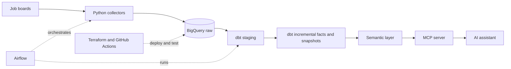

# Paris Data Jobs Platform

A small data platform built on real, changing data: Data Engineer job postings in Paris, collected every day from public job boards. Each week adds one layer of a modern data stack, from raw tables in BigQuery to an AI assistant that answers questions through a semantic layer.

## Why this data

Job postings have the problems production pipelines have:

- **Duplicates.** The same job is often posted on several sites.
- **Late data.** A posting can appear days after its publication date.
- **Deletions.** Postings close, and the history of when they were open matters.
- **Schema changes.** Job sites change their pages, so fields appear and disappear.

## Architecture

The target, built layer by layer:



## Status

| Week | Layer | Status |
|---|---|---|
| 1 | BigQuery: raw tables and first analyses | In progress |
| 2 | dbt: staging models, tests and docs | Planned |
| 3 | dbt: incremental models, snapshots and macros | Planned |
| 4 | Airflow: orchestration, retries and backfills | Planned |
| 5 | Terraform and GitHub Actions | Planned |
| 6 | Cloud Run, Pub/Sub and data observability | Planned |
| 7 | Semantic layer and an MCP server | Planned |
| 8 | Documentation and demo | Planned |

## Data

The postings come from a separate collector that I keep private. It reads four public job boards, re-checks whether postings are still open, and exports two newline-delimited JSON files, described in [docs/data.md](docs/data.md):

- `postings.ndjson`: one row per posting, with its description and the skills it names.
- `posting_checks.ndjson`: one row each time a posting was checked, with whether it was still open.

The files keep every posting as collected, so the same job can appear once per board; cleaning that up is part of this project. They are not published here, because they contain text copied from job sites. `data/` is ignored by git.

## Run it

1. Copy the latest export into `data/raw/<today>/`:

   ```bash
   python scripts/sync_data.py
   ```

2. In the [BigQuery sandbox](https://cloud.google.com/bigquery/docs/sandbox), create a dataset named `jobs_raw`.
3. Create the table `postings` from `data/raw/<today>/postings.ndjson`: source "Upload", file format "JSONL (Newline delimited JSON)", schema "Auto detect". Do the same for `posting_checks`.
4. Run the queries in [analyses/](analyses/).

## Repository layout

| Path | Contents |
|---|---|
| `analyses/` | SQL analyses run in BigQuery |
| `docs/` | Data dictionary and design notes |
| `scripts/` | Helper scripts |
| `data/` | Local data files, ignored by git |
| `LOG.md` | What I learned each week |
